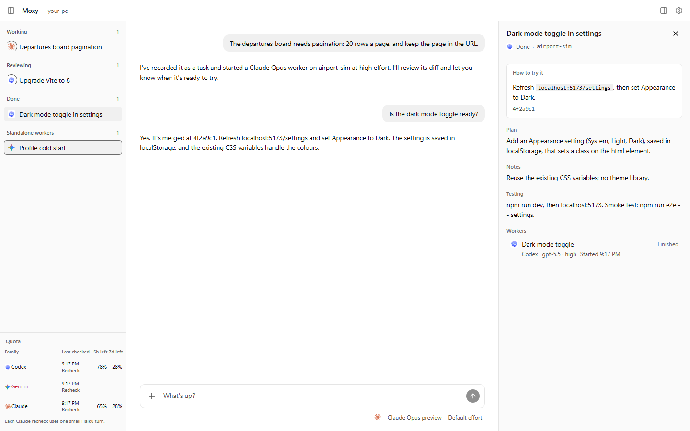
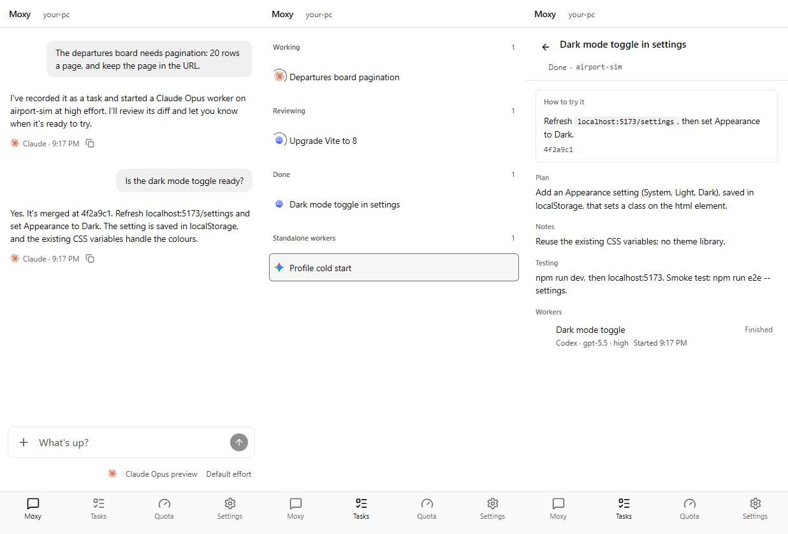

# Moxy

Moxy is a Windows coding coordinator for a developer who wants to manage work from a phone. One long-running AI conversation plans tasks and delegates them to coding-agent CLIs. Workers code in separate git worktrees; Moxy reviews and merges their work, then sends a notification with instructions for trying it.

## How it works

1. Send a message from your phone.
2. Moxy records a task and picks an engine, model and effort.
3. A worker codes in its own git worktree.
4. Moxy reviews and merges the work.
5. You get a notification saying how to try it.

Moxy drives the coding CLIs you already have signed in, using their own sign-ins. Moxy does not need provider API keys of its own.





## Requirements

- Windows 10 or 11, Node.js 24.11.0 or later, and Git with `user.name` and `user.email` configured.
- Tailscale signed in on the PC and phone, with HTTPS enabled for Tailscale Serve.
- At least one supported coding CLI installed, signed in and on PATH. Claude leads by default. Claude, Codex, Gemini (`agy`), Kimi and DeepSeek can lead; Cursor, Grok and OpenCode are workers only.
- For direct leader launches, `agy`, `kimi` and `dsh` need a real `.exe` or `.com` on PATH. Workers launched through Claw can also use npm `.cmd` shims.

## Install and first run

Open a normal, non-elevated PowerShell and run:

```powershell
git clone https://github.com/duckling1169/moxy.git
cd moxy
npm ci
npm run build
npm link
moxy install
moxy status
```

`moxy install` installs a supported [Claw Orchestrator](https://github.com/Enderfga/claw-orchestrator) if needed, allows the signed-in Tailscale login, configures Serve when the HTTPS root is available, and registers a Windows logon task. If the root is already in use, follow the command printed by install. It starts Moxy unless it is already running.

On your phone, open the PC's Tailscale Serve address, such as `https://your-pc.your-tailnet.ts.net/`. Add it to your home screen. On iPhone or iPad, open the home-screen app before enabling notifications in Settings. Enable notifications on each device where you want them. Try a first message such as: "In `C:\Code\my-project`, inspect the README and suggest one small improvement."

To index repositories, add their parent folders to `repoFolders` in `~/.moxy/config.json`, for example `"repoFolders": ["C:\\Code"]`, then run `moxy restart`. Without that setting, give Moxy the repository path. `moxy say <text>` sends a message from the PC. `moxy stop`, `moxy restart`, `moxy upgrade-claw`, and `moxy uninstall` manage the local installation; uninstall keeps data, Claw and Serve configuration.

## Quota checks

Moxy checks Codex through app-server, Gemini through `agy /usage`, and Claude with a small Haiku probe turn with tools disabled and no saved session. The automatic check runs every five minutes by default, including Claude: up to 288 tiny Haiku turns per day while Moxy runs. Change the interval in Settings or set `quotaRefreshMinutes` in `~/.moxy/config.json` to a whole number from 1 to 1440. Set it to `0` to turn automatic checks off. Manual checks remain available. Codex and Gemini also refresh after a turn, at most once per minute; Claude does not.

## Security

Remote access requires a Tailscale login listed in `allowedLogins`; an explicit empty list allows nobody. Writes check Host and Origin. Anything on the machine that can reach loopback is trusted. Workers run as your Windows user. Codex and agy workers have full access, so a worker can do anything your account can.

## Limits

Moxy is for one user and runs on Windows. It keeps worktrees rather than cleaning them up. Claw is a separate project. Notification delivery depends on the device and push service.

## Architecture

One daemon stores conversation and task state in SQLite. The leader receives messages and worker results through a durable inbox, delegates through Claw, and integrates work with Git. A loopback web server is exposed to your tailnet through Tailscale Serve. See [DESIGN.md](DESIGN.md) for behavior and boundaries and [IMPLEMENTATION.md](IMPLEMENTATION.md) for implementation details.

## Development

```powershell
npm ci
npm run check
npm run web:preview
npm run test:web
```

The preview at `http://localhost:18799` uses fake data and runs no models. Playwright tests desktop and mobile flows. Contributor instructions are in [AGENTS.md](AGENTS.md). To regenerate screenshots, start the preview and run `npx tsx scripts/capture-screenshots.ts`.

## Credits

[Claw Orchestrator](https://github.com/Enderfga/claw-orchestrator) by Enderfga runs workers. Moxy uses [SQLite](https://sqlite.org), [semver](https://github.com/npm/node-semver), [web-push](https://github.com/web-push-libs/web-push), [shadcn/ui](https://ui.shadcn.com), [Lucide](https://lucide.dev), and [Lobe Icons](https://github.com/lobehub/lobe-icons). More design credits are in [IMPLEMENTATION.md](IMPLEMENTATION.md).

## License

[MIT](LICENSE)
